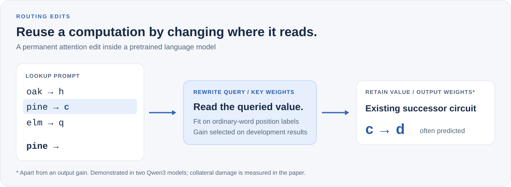
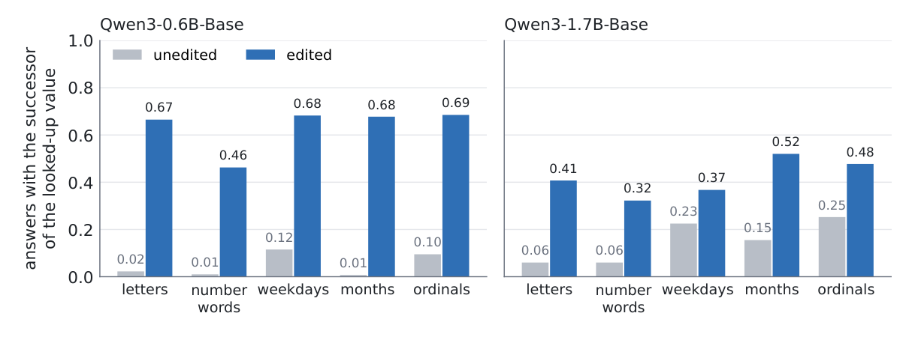

# Routing Edits

**Reusing a Successor Circuit through Attention Weight Changes**<br>
Yucheng Wang · University of Wisconsin–Madison · Preprint, November 2026

[Read the paper](paper/main.pdf) · [Reproduce the results](docs/reproduction.md) · [Browse the evidence](results/README.md) · [MIT license](LICENSE)



A small language model can continue `c d e` with `f`, and it can retrieve `c` from a table, but it does not apply the first to the result of the second: on lookup prompts, the item *after* the retrieved value is its answer only 1–25% of the time. Can that connection be made directly in the weights, by reusing the model's own successor computation and changing only where it reads?

We locate an attention head involved in sequence succession in two Qwen3 models and rewrite its query and key weights so that it attends to the value selected by a lookup query. Its value and output weights are kept, apart from an output gain. For a table containing `pine -> c`, the query `pine ->` then often elicits `d`. The routing fit uses ordinary-word lookups and position labels, without successor targets; the output gain was chosen using development performance on the composed task.

## Main result



| Model | Unedited successor rate | Edited successor rate |
| :--- | :---: | :---: |
| Qwen3-0.6B-Base | 1–12% | 46–69% |
| Qwen3-1.7B-Base | 6–25% | 32–52% |

Ranges span five value types in the fitted prompt format, with **400 fresh prompts per value type** and keys excluded from fitting. The paper also evaluates two other prompt formats. The metric checks the first answer token.

Ablation, output swaps and routing controls connect the effect to the selected head's existing computation: the same attention installed in other heads does not reproduce it.

**A model as the weight programmer.** Given circuit-level primitives and model diagnostics, Claude Opus 5.5 built working edits in all three runs, and in each it proposed a design we had not built: copying the successor circuit into a different head, so that the original head can keep its native role. Its programmes are comparable to the hand-designed edit, not uniformly better, and three runs without an equal-budget random-search baseline do not establish an advantage for LLM-guided search.

**Scope and cost.** The direct edit raises loss on the fixed WikiText sample by 14–17% at the reported gain. Gradient training on routing labels performs similarly, and fine-tuning on composed examples performs substantially better. Both models belong to the same family. This is evidence for a specific circuit-reuse mechanism, with limited preservation measurements and no claim of a general model-improvement method.

## Start with saved results

Reading the [PDF](paper/main.pdf) and browsing the saved JSON files requires no model download or API key. To regenerate the paper's tables and figures from the repository root:

```bash
python -m pip install matplotlib
python paper/make_tables.py
python paper/make_figures.py
```

These commands read saved results; they do not run models or contact an LLM service. For environment setup, model execution, paper compilation and the API-based designer, see the [reproduction guide](docs/reproduction.md).

## Repository guide

| Location | Contents |
| :--- | :--- |
| [`paper/`](paper/README.md) | Current manuscript, PDF, figure/table generators and source packaging |
| [`experiments/compose/`](experiments/compose/) | Routing fit, head selection, causal controls, learning comparisons and designer harness |
| [`results/`](results/README.md) | Saved measurements, fitted routing matrices and experiment logs |
| [`docs/`](docs/README.md) | Reproduction instructions and historical research protocols |
| [`output/`](output/README.md) | Packaged preprint PDF, LaTeX source bundle and submission text |
| [`tests/`](tests/) | Existing software checks for the earlier experimental harnesses |

Earlier work on evolutionary weight editing, reasoning efficiency and synthetic dynamics is retained as research provenance. The [results index](results/README.md) separates those studies from the routing-edit evidence. Their original file paths are preserved so archived scripts and result records remain interpretable.

## Cite this work

```bibtex
@misc{wang2026routing,
  title  = {Routing Edits: Reusing a Successor Circuit through Attention Weight Changes},
  author = {Wang, Yucheng},
  year   = {2026},
  note   = {Preprint},
  url    = {https://github.com/Richard-Y-W/Machine-learning-research-paper}
}
```

The manuscript is available in this repository; an arXiv identifier has not yet been assigned. Machine-readable repository citation information is in [`CITATION.cff`](CITATION.cff).

## License

The research code is released under the [MIT license](LICENSE). Third-party model weights, datasets and dependencies retain their own licenses and terms. This repository contains fitted edit tensors and results, rather than full Qwen checkpoints.
