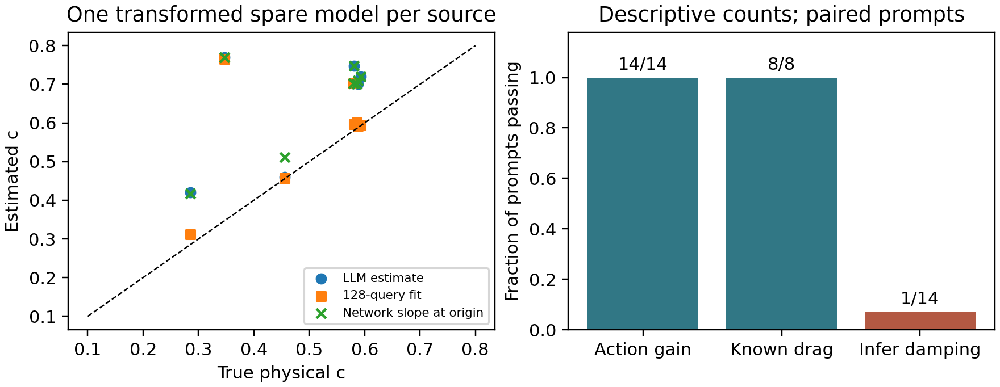

# Direct Weight Editing Does Not Establish Physical Parameter Recovery: A Controlled Pilot

Exploratory research draft | November 11, 2026 | Primary pilot plus prespecified independent-source follow-up

## Abstract

Can an LLM directly modify a learned dynamics network from its numerical weights, and does successful editing imply recovery of the physical mechanism represented by that network? We distinguish numerical compilation of an explicit functional change from inference of an unknown physical coefficient. Claude Opus 5.5 received raw weights of small trained ReLU acceleration networks and returned numerical parameter replacements without tools, examples, forward passes, optimization, or evaluation feedback. A frozen 24-call pilot and a prespecified 12-call follow-up produced 36 valid patches from eight independently trained sources. Action-input rescaling passed 14/14 trials, and a specified additive drag change passed 8/8. Doubling an undisclosed physical damping coefficient passed 1/14. Nevertheless, every semantic patch accurately implemented the model's own estimated coefficient, with maximum normalized compilation error 6.89e-07. A post hoc diagnostic found that seven of eight source-level estimates closely tracked the represented network's local velocity slope, which need not match its training system's physical coefficient. This pilot demonstrates genuine direct weight manipulation while exposing a measurement problem: editing accuracy, network reading, and physical parameter recovery require separate ground truths. It does not establish a general limitation of weight-space programming or a new editing algorithm.

## 1. Motivation and scope

Recent weight-space programming demonstrations motivate treating LLMs as readers and writers of neural parameters [1]. Exploratory audits already distinguish local weight arithmetic from broader semantic claims [2]. A useful research question must go beyond demonstrating that a model can multiply entries in a weight matrix. We ask where a successful numerical edit ends and recovery of an underlying physical mechanism begins.

Our setting uses fully observed position, velocity, and force. The edited network predicts acceleration. This is a controlled dynamics component, not a learned latent world model, visual agent, or closed-loop controller. The small scale makes every proposed replacement independently checkable on CPU. The external LLM performs the editing; the research harness subsequently evaluates its frozen output. Earlier numerical adaptation experiments in this repository are historical baseline studies and are excluded from the evidence reported here.

Weight processing itself is established: neural functional networks explicitly account for hidden-neuron permutation symmetry [3], and system identification estimates dynamical laws from observations [4]. Our present contribution is a diagnostic experimental decomposition, not an invention of either idea. Given the direct overlap with prior local-arithmetic audits [2], publication novelty remains unresolved.

## 2. Tasks and systems

For each source seed, we train a one-hidden-layer 3-12-1 ReLU network with 61 scalar parameters on the pendulum-family acceleration law below. The four positive coefficients vary across sources and are withheld from the editor. Inputs are position q, velocity v, and applied force u. The editor is told these meanings and the functional family.

$$ a(q,v,u)=-k\sin(q)-cv-\alpha v|v|+gu $$

Training uses 4,096 uniform points in [-1.5,1.5]^3, double precision, batches of 256, and 6,000 Adam steps. The learning rate is 0.005, reduced by a factor of five after step 4,500. Training is local CPU computation with two Torch threads. Each tensor is serialized to eight decimal places; every editing target is defined relative to that serialized network, rather than its unrounded predecessor.

$$ f_w(x)=W_2\operatorname{ReLU}(W_1x+b_1)+b_2 $$

The primary pilot crosses two sources (seeds 90-91), two capacity conditions, two representations, and three requests. The learned-width condition retains all 12 trained units. The spare condition appends two zero-output units, giving 71 parameters without changing the source function. Each network is shown either in its original coordinates or after a hidden-unit permutation and positive rescaling of incoming weights and biases, compensated in the outgoing weights. Eight-decimal serialization makes these representations approximately equivalent. Targets always use the particular serialized representation supplied to the editor.

The three requests are: action gain, f_new(q,v,u)=f_w(q,v,1.5u); known added drag, f_new(x)=f_w(x)-0.2v; and semantic damping, infer the undisclosed coefficient c and implement f_new(x)=f_w(x)-cv. For semantic damping, the goal is to double the physical linear damping while preserving the source's other behavior. The distinction between the training coefficient c and any local derivative of f_w is central to interpreting that task.

The follow-up was specified before inspecting primary editing outcomes. It adds six independent sources (92-97), using only the transformed spare representation and the action-gain and semantic requests. It keeps the same prompt and API settings. These are 12 additional trials. Across both cohorts there are eight independently trained source functions, not 36 independent networks. The primary and follow-up reports remain separate; pooled counts are descriptive.

## 3. Editor access, controls, and evaluation

Each stateless API call uses Claude Opus 5.5 (claude-opus-5-5), adaptive thinking, medium effort, and a maximum of 4,096 output tokens. The model receives architecture, numerical tensors, input/output meanings, the physical-family prior, and one edit request. It receives no source code, true coefficients, training observations, evaluation queries, tools, executable environment, forward-pass results, or feedback. It must return a JSON list of indexed numerical parameter replacements plus a brief public explanation and, for semantic requests, its estimate of c. There are no optimization calls after generation. Applying those numbers changes the actual deployed neural parameters.

One unrelated development source (seed 89) checked API transport and patch format on action gain. No prompt changes followed. The primary prompt and fixtures were committed before generation in 921c9ce. The follow-up protocol was committed in 3473d63 and its fixtures sealed before follow-up calls. Canonical JSON hashes protect public weights, prompts, and separately stored evaluation metadata. All 36 evaluated responses ended normally; none was retried or repaired. The development call is excluded from success counts. Estimated standard list-price usage was $1.2471 for evaluated calls and $1.2756 including development, below the shared $3 reservation cap. Local CPU work is not included in that API cost [5].

Controls include the unchanged network, an exact input-column scaling compiler, an exact spare-unit compiler, a physical-library fit using 128 source queries followed by compilation, a fixed c=0.4 prior followed by compilation, and numerical output-head fitting. Oracle-coefficient references are marked as oracle methods. Query-based controls have access unavailable to the tool-free LLM, so they are diagnostic references rather than equal-information competitors. A fixed prior of 0.4 is the mean of the coefficient-generating distribution; it is not fitted on pilot results or supplied to the LLM.

For an explicit additive correction, two spare ReLU units implement -d ReLU(v)+d ReLU(-v)=-dv. A single unit known to be inactive on the domain can instead be repurposed as ReLU(v+B), with B at least one and a compensating output-bias change. These are elementary architectural constructions. Dense learned-width networks can contain inactive units, so their label does not imply fully occupied capacity.

We evaluate 4,096 independently generated points in [-1,1]^3 and 4,096 in the larger [-1.5,1.5]^3 cube. Edit NRMSE divides functional error by the RMS magnitude of the requested change; doing nothing scores one. Collateral error measures changes on u=0 for action gain and v=0 for drag. Prespecified passing thresholds are NRMSE at most 1e-4 and collateral RMSE at most 1e-6 for action gain; NRMSE at most 0.05 for known drag and 0.10 for semantic damping; and collateral RMSE at most 0.01 for both drag tasks. Extrapolation error is reported separately and is not part of this pass criterion. Invalid and truncated patches fail; no cases were unattempted.

## 4. Results

All 36 responses supplied valid numerical patches. Table 1 separates the two cohorts. Exact arithmetic controls passed in every tested representation. Semantic requests usually failed the requested physical-coefficient target, despite preserving the zero-effect set.

| Request | Primary passed | Follow-up passed | Combined | Mean edit NRMSE |
|---|---:|---:|---:|---:|
| Action gain | 8/8 | 6/6 | 14/14 | 3.88e-16 |
| Known drag | 8/8 | Not scheduled | 8/8 | 7.33e-16 |
| Infer damping | 0/8 | 1/6 | 1/14 | 0.3452 |

Table 1. Functional success counts under the frozen thresholds. Capacity and representation copies share source functions; these fractions are not estimates based on 36 independent sources. Known drag was evaluated only on two independent source functions.

### 4.1 Numerical programming succeeded

Action patches rescaled the force-input column of W1 and achieved error at floating-point precision. For known drag, the model successfully used both explicitly supplied spare units and naturally inactive learned units. For source 90, it identified a unit whose preactivation was bounded above by approximately -0.30 throughout the evaluation domain. It replaced that unit with ReLU(v+1), set its outgoing weight to -0.2, and raised the output bias by 0.2. The resulting correction was -0.2v on the domain. This behavior is evidence of architectural reasoning and direct weight writing in this small setting.

Both primary sources already had bound-certified inactive learned units (two in source 90 and one in source 91). Thus 4/4 known-drag successes in the learned-width condition cannot establish that the editor can integrate a new mechanism into fully utilized representations. Some domain-specific edits also extrapolated imperfectly: combined known-drag OOD NRMSE was 0.03327, despite essentially exact in-domain behavior. An inactive unit on one cube may become active on a larger cube, and a shifted ReLU correction need not remain linear outside its intended interval.

### 4.2 Compiling an estimate and recovering a coefficient are different

Every semantic patch implemented the LLM's own declared coefficient with normalized error below 6.89e-07. The dominant failure was therefore not numerical execution of the proposed correction. For example, source 90 has physical c=0.59335; in the transformed spare condition the model estimated 0.72 and accurately compiled -0.72v. That is a valid weight program for its estimate but an inaccurate program for the prespecified -0.59335v target.

To avoid pseudoreplication, Table 2 uses one common condition per independently trained source: transformed representation with spare capacity. The 128-query coefficient fit uses the same physical library supplied as a prior to the editor. It does not observe physical targets or true c.

| Seed | Physical c | LLM estimate | Local slope | Query fit |
|---|---:|---:|---:|---:|
| 90 | 0.59335 | 0.72000 | 0.71969 | 0.59289 |
| 91 | 0.28506 | 0.42000 | 0.41712 | 0.31119 |
| 92 | 0.58749 | 0.70000 | 0.70918 | 0.59236 |
| 93 | 0.57990 | 0.70200 | 0.70203 | 0.70150 |
| 94 | 0.45517 | 0.46000 | 0.51196 | 0.45644 |
| 95 | 0.58590 | 0.70400 | 0.70033 | 0.60057 |
| 96 | 0.58027 | 0.74718 | 0.74718 | 0.59687 |
| 97 | 0.34716 | 0.76930 | 0.76934 | 0.76557 |

Table 2. Independent-source coefficient diagnostics. Local slope is the negative velocity derivative of the represented network at the origin, computed after evaluation. The query fit uses 128 function evaluations unavailable to the LLM.

Across these eight source-level observations, coefficient MAE was 0.15102 for the LLM, 0.07550 for the query fit, 0.14373 for the fixed prior, and 0.15782 for the network's origin slope. These small-sample descriptive comparisons do not establish superiority or equivalence. In particular, the LLM did not beat the prior in mean absolute coefficient error on these eight sources.

Figure 1. Left: coefficient estimates for eight independent sources, using one common capacity/representation condition. Right: pooled functional pass counts; individual prompts are paired variants, not independent source replications.

### 4.3 Post hoc explanation: local reading versus physical identification

For seven of eight independent sources, the LLM coefficient was within 0.01 of the network's negative velocity derivative at the origin; mean absolute discrepancy was 0.00851. This is consistent with local arithmetic on active paths. It is an output-based diagnostic, not an observation of the model's internal reasoning. The sole successful semantic edit, source 94, estimated 0.46 against true c=0.45517 and local slope 0.51196, showing that this explanation is not universal.

In the exact physical family, the negative velocity derivative at the origin equals c. In a trained finite ReLU approximation, however, small prediction error does not ensure accurate derivatives. The represented slope can therefore be read correctly while yielding the wrong physical coefficient. Source acceleration RMSE ranged from 0.01124 to 0.09300; all sources were retained without outcome-based filtering. Source 97 was the poorest approximation, and even its query-library estimate was 0.76557 versus true c=0.34716. Source 93 also had appreciable query-fit bias. These cases prevent interpreting every semantic failure as inability of the LLM to use information reliably present in the source function.

The appropriate decomposition has three checks: recover a stated property of the represented network; recover a property of the training system; and compile the chosen property into an edit. This pilot directly validates the third for simple corrections, provides evidence of local network reading, and exposes a confound in the second. It does not establish fundamental non-identifiability of c from the full weights, nor does it prove that a stronger prompt or model would fail.

## 5. Limitations and next falsification

This is a single-model, single-prompt, single-generation pilot with eight trained sources and 61-71 parameters. Only two sources support the full capacity and representation factorial. No confidence interval treating prompt variants as independent is justified. Coefficient variation is also limited and several sampled c values are similar. Equivalent-representation successes on elementary edits do not establish general representation invariance. We evaluate acceleration and targeted collateral slices, not trajectory stability, conservation, visual understanding, control reward, or latent causal factors.

The task discloses the physical family and input meanings. Semantic failure against a hidden training coefficient conflates reading strategy with representation fidelity; query-based controls reduce but do not remove that ambiguity. Arithmetic editing has exact elementary compilers, and naturally inactive neurons ease the learned-width condition. Consequently neither perfect arithmetic-control performance nor the low semantic pass count supports a broad capability claim. API generation settings and a finite output budget further limit external validity.

The next study should prespecify a crossed design separating exactly encoded target properties from approximate learned physical properties. It should independently vary source prediction and derivative accuracy, use wider coefficient ranges and more source seeds, and include representations without spare or inactive units. Explicit-coefficient editing controls should be matched to the same requested changes. Strong deterministic weight readers, query-library fitting, and at least a second editor model are needed. These changes address the measurement ambiguity before paying for larger models or cluster-scale training. No such additional results are claimed here.

## 6. Research conclusion

Direct raw-weight programming is real in this pilot: an independent LLM returned numerical patches that changed trained neural parameters and implemented 22/22 explicitly specified functional transformations. The harder physical-coefficient request passed 1/14, while compilation of the model's own coefficient remained accurate. Most independent-source estimates instead tracked a local property of the represented network. This is a concrete basis for a study of when weight-derived properties support semantic edits, but the present sample and source-fidelity confound are insufficient for a submission-quality general claim. The next research gate is a better controlled identification benchmark, not merely larger compute.

## Reproducibility and release

The repository includes frozen prompts and canonical fixture hashes; separately stored physical evaluation metadata; final numerical patches; API model/usage records without credentials or thinking blocks; raw per-case metrics; source-level coefficient diagnostics; the budget ledger; and this generated draft. Evaluation requires no API key. The primary and follow-up protocols were committed before their respective calls. Local evaluation and reporting are deterministic; external API responses are archived rather than claimed to regenerate bit for bit. Commands and access contracts are documented in README.md and docs/wsp-protocol.md.

## References

[1] Takehi, R., Teoh, J., Zhang, A., and Khattab, O. (2026). Sparks of Weight-Space Programming: LLMs can natively read and write neural network weights. Research blog, November 2. https://rikiyat.github.io/blog/weight-space-programming/

[2] Ahmed, N. S. (2026). Can an LLM Actually Reason and Program about Neural Network's Weights or is it just memorization on steroids? Exploring Weight-Space Programming. Exploratory preprint. https://arxiv.org/abs/2611.08070

[3] Zhou, A., Yang, K., Burns, K., Cardace, A., Jiang, Y., Sokota, S., Kolter, J. Z., and Finn, C. (2023). Permutation Equivariant Neural Functionals. https://arxiv.org/abs/2302.14040

[4] Brunton, S. L., Proctor, J. L., and Kutz, J. N. (2016). Discovering governing equations from data by sparse identification of nonlinear dynamical systems. PNAS 113(15), 3932-3937. https://doi.org/10.1073/pnas.1517384113

[5] Anthropic. Claude API model overview, Messages API, and pricing. Accessed November 10, 2026. https://platform.claude.com/docs/en/about-claude/pricing
