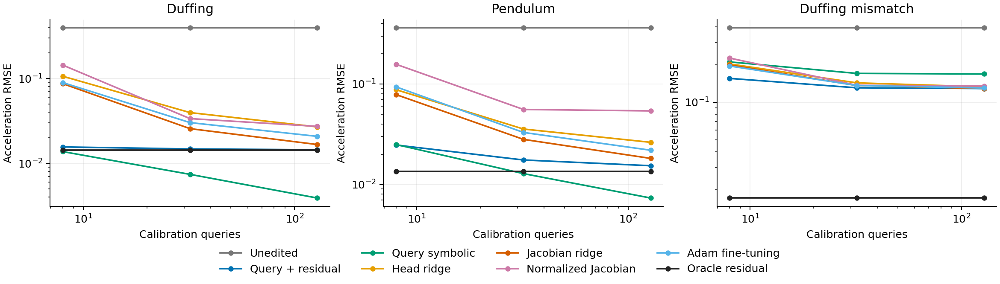
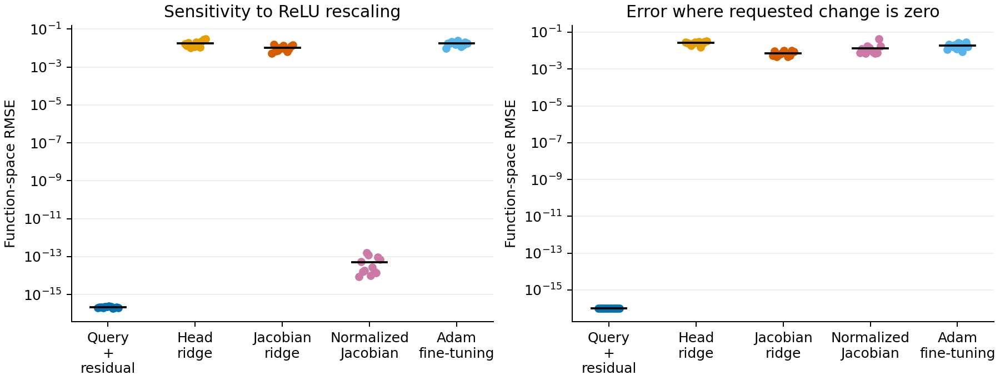

# Before Programming the Weights: Structured Query Baselines for Editing Learned Dynamics

**Exploratory research draft - November 10, 2026.** This document reports a completed feasibility study, not a submission-ready paper. Author list and publication venue are intentionally unset. No novel optimization algorithm or LLM capability is claimed.

## Abstract

Directly editing a neural network's weights is an appealing interface for changing a learned dynamics model. However, successful edits may be uninformative when a low-dimensional behavioral model already determines the requested change. We study this issue in controlled acceleration predictors for two oscillator families and a deliberately misspecified variant. All editors receive a documented state-action interface, a mechanism library, a multiplicative intervention, and the same calibration outputs. We compare structured query corrections, numerical parameter edits, and ordinary fine-tuning across independently trained networks, query budgets, and exact function-preserving reparameterizations. {{ABSTRACT_RESULTS}} These observations motivate stronger behavioral baselines and explicit deployment contracts before attributing an advantage to weight-space access. They do not establish a limitation of LLM weight-space programming or of high-dimensional world models.

## 1. Introduction

When a learned model predicts the evolution of an environment, changing the environment raises a natural question: can we directly modify the model to reflect the change? Weight-space programming makes this question particularly timely. Recent exploratory reports describe language models inspecting and rewriting numerical network parameters [7,8]. More broadly, neural functional networks already process networks as structured parameter objects [5].

An attractive demonstration would ask an editor to double damping in a learned physical simulator and display the resulting trajectories. Such a result is insufficient to establish why weight access matters. If the underlying acceleration lies in a known four-dimensional feature span, four appropriately chosen noiseless behavioral measurements can already determine its coefficients. The relevant competitor is then a structured query method, not simply the unchanged network.

We conduct a falsification-first pilot before investing in an LLM editor. The objective is to identify a setting in which weight access earns a practical advantage, or to discover why a seemingly attractive benchmark fails to provide that opportunity. The systems are deliberately small enough to expose assumptions and run on an ordinary CPU. We use learned acceleration predictors with observed physical states; describing these as full visual or latent world models would overstate the scope.

The study makes three limited contributions: an executable comparison with shared semantic information; a paired test of editing under equivalent network representations; and a decision about whether this particular benchmark warrants further investment. The algebra below explains the expected behavior of the baselines. It is elementary and is not presented as new theory. Publication novelty remains to be established.

## 2. Related work and distinctions

**System identification.** Recovering dynamical laws from a candidate feature library is a longstanding approach. Sparse identification of nonlinear dynamics [1] is a prominent example. Our baseline fits a supplied dense four-term library by ordinary least squares. It neither performs sparse structure discovery nor reproduces the full SINDy procedure. Supplying the correct library is a strong prior, and it is made available to every editor.

**Weight-space learning and model changes.** Permutation-equivariant neural functionals [5] establish that other networks' weights can be processed with their symmetry structure respected. Task arithmetic [6] studies combining parameter changes around a common base. We train neither a neural functional nor a reusable meta-editor. A jointly specified two-coefficient intervention is also not evidence of sequential edit composition.

**Optimization geometry.** Function-preserving ReLU rescalings alter Euclidean parameter geometry. Scale-aware optimization predates this study [2], and reparameterization confounds are well established [3]. We use these transformations as diagnostic controls. The column-normalized Jacobian update is a transparent numerical comparator, not a proposed novel optimizer.

**World-model adaptation.** Variational Causal Dynamics [4] learns modular transition structure and adapts to interventions. Our setting is substantially narrower: physical state semantics and a mechanism library are provided, changed-environment observations are absent, and the intervention is explicitly specified. We do not compare against or claim to improve on VCD. Recent WSP demonstrations [7] and shortcut audits [8] motivate the question, but no language model is evaluated here.

## 3. Problem and access contracts

Let x=(q,v,u) contain position, velocity, and a force input. A network f_theta(x) predicts acceleration, with position derivative v. The true acceleration has a supplied library phi and coefficients c:

$$ f_c(x)=\phi(x)^T c. $$

A specified intervention multiplies selected coefficients. Writing M=diag(m), the changed model has coefficients (I+M)c. Damping doubling has m=(0,1,0,0); increasing the first restoring coefficient by 50% has m=(0.5,0,0,0); the combined intervention applies both.

Every non-oracle method receives the library, intervention, interface, and n noiseless outputs of the learned base network at the same calibration inputs X. The physical coefficient values are withheld. All methods use the same estimate c_hat=Phi^dagger f_theta(X), where Phi is the calibration feature matrix. Numerical editors therefore share an identical semantic target:

$$ t(X)=f_\theta(X)+\Phi M\widehat{c}. $$

This design isolates the difficulty of realizing a requested function change. It does not compare alternative ways to infer intervention semantics from weights. Weight access is a computational interface, not an information-theoretic restriction: executable weights permit behavioral queries too.

Two deployment contracts must be distinguished. A weight editor preserves the network architecture. A query residual adds a structured path around the unchanged model, while symbolic replacement uses a different model class entirely. Their performance is relevant to whether the task needs weight editing, but does not establish superiority under equal parameter count, latency, or architectural constraints.

## 4. Why simple queries may suffice

**Observation 1: exact identifiability in the matched library.** Suppose the base predictor equals f_c and Phi has full column rank p. Then c_hat=c. With p linearly independent noiseless queries, a residual implementation f_theta(x)+phi(x)^T M c_hat exactly realizes the intervention. We do not claim that any arbitrary p queries have this property, or that p queries suffice under noise, unknown features, or a misspecified library.

**Observation 2: the source of residual-edit error.** Suppose f_theta(x)=phi(x)^T c+e(x), and let e_X be its errors on calibration inputs. Full column rank gives c_hat=c+Phi^dagger e_X. The physical prediction error after a query residual is:

$$ e(x)+\phi(x)^T M\Phi^\dagger e_X. $$

The error after symbolic replacement is:

$$ \phi(x)^T(I+M)\Phi^\dagger e_X. $$

Thus symbolic replacement can outperform even an oracle residual by removing base-model approximation error. The oracle residual is an exact functional-change reference, not a lower bound on physical prediction error. Conditioning of the calibration library controls amplification of approximation errors.

**Observation 3: physical semantics require assumptions.** If an arbitrary residual r is allowed, the same function admits phi(x)^T c+r(x)=phi(x)^T(c+d)+[r(x)-phi(x)^T d]. An intervention defined as modifying c can differ between these decompositions. Neither weights nor unlimited function queries identify which decomposition has the intended physical meaning without further restrictions. Our misspecified-library condition is a stress test of this issue, not a general identifiability result.

## 5. Experimental design

**Systems.** The Duffing library is (-q,-v,-q^3,u). The pendulum library is (-sin(q),-v,-v|v|,u). A third condition adds 0.3 sin(3q) to Duffing acceleration while retaining the Duffing library supplied to the editors. Its unmodeled term is preserved by the true intervention. Per seed, four coefficients are sampled from [0.7,1.3], [0.2,0.6], [0.1,0.4], and [0.8,1.2]. Matching seed indices pair coefficients and training randomness across families; family results are therefore clustered by seed.

**Base predictors.** We train a 3-32-32-1 ReLU MLP, with 1,217 parameters, independently for each family and seed. Training uses 4,096 noiseless acceleration labels in [-1.5,1.5]^3, 2,400 Adam updates with batch size 256, learning rate 0.003 reduced fivefold after 75% of training. This is direct acceleration supervision; the models do not infer latent physical states or learn from pixels. Training is in float32; editing and evaluation use float64. {{TRAINING_RESULTS}}

**Editors.** Unedited is the negative reference. Query residual implements the fitted four-feature correction around the base model. Query symbolic replaces the base by the intervened fitted library. Head ridge changes only the output affine layer. Jacobian ridge performs three damped linearized parameter updates. Normalized Jacobian uses the same procedure after normalizing each nonzero Jacobian column by its calibration norm. Both use a ridge factor of 1e-4 times the mean kernel diagonal and a fixed five-value backtracking schedule. Adam fine-tuning runs 150 full-batch steps at learning rate 0.003 on the same synthetic targets. Oracle residual substitutes the true coefficient values and is excluded from non-oracle comparisons. These baselines were not exhaustively tuned.

**Representation controls.** For each network we rerun edits in its original representation, after hidden-unit permutations, and after positive hidden-unit rescalings. Each hidden-unit scale is log-uniform between 0.1 and 10, with inverse scaling on outgoing weights. These transformations preserve the base function. The experiment asserts maximum pre-edit disagreement below 1e-9. A normalized Jacobian's diagonal-coordinate equivariance is checked separately by an algebraic unit test. No raw edit vector is transferred between independently trained networks.

**Budgets and metrics.** Calibration sets contain 8, 32, or 128 base-model queries, nested within a seed and shared across methods. Additional optimization and Jacobian work is recorded separately; calibration-query matching is not compute matching. We evaluate acceleration on 1,024 held-out points in [-1.25,1.25]^3 and 1,024 extrapolation points in [-2,2]^3 outside the training cube. Edit discrepancy compares the realized function change to the change defined by true physical coefficients, normalized by the latter's RMS. Collateral discrepancy is measured where the requested immediate acceleration change is zero.

Rollout evaluation uses 24 initial states, a shared sinusoidal force sequence, 100 semi-implicit Euler steps, and step size 0.03. The reference uses the same integrator with the intervened analytic acceleration. Rollout error averages position and velocity errors over trajectories and time. These are short-horizon prediction tests, not planning or closed-loop control. Divergence and nonfinite metrics are counted explicitly.

**Statistical unit.** Twelve independent training seeds produce 36 base models and {{NROWS}} condition-method measurements. We first average conditions within each seed and use 5,000 paired seed-cluster bootstrap resamples. Reported intervals are exploratory 95% percentile intervals. State points, interventions, and equivalent representations are not treated as independent replications. The study is exploratory, with no multiplicity correction or confirmatory significance claim.

## 6. Results

### 6.1 Matched dynamics and query baselines

{{MAIN_RESULTS}}

{{MAIN_TABLE}}

Table 1. Matched Duffing and pendulum libraries, original parameterization, 128 calibration queries. Entries are seed-cluster means. The full report contains intervals. Lower is better. Different deployment contracts prevent an equal-capacity interpretation.

{{PAIRED_RESULTS}}

Figure 1. Acceleration error versus calibration budget, averaging interventions and independent seeds within each system. Lines summarize an exploratory sweep; uncertainty estimates are supplied in the machine-readable summary and report. The third panel intentionally violates the supplied mechanism library.

### 6.2 Equivalent representations

{{GAUGE_RESULTS}}

The normalized update's behavior has a straightforward explanation. Under a positive diagonal coordinate transformation, Jacobian columns transform inversely with the parameter coordinates. Normalizing their magnitudes removes this scaling from the linear solve, and the resulting update transforms back with the parameters. This observation is restricted to those coordinate transformations and to the stated handling of inactive columns; it is not invariance to arbitrary nonlinear reparameterizations. The empirical result checks an implementation consequence of known optimization geometry.

Figure 2. Each point averages matched families and interventions within one independent seed, at 128 queries. Left: disagreement with the edited original representation after ReLU rescaling. Right: immediate collateral error on the intervention's zero-effect set. Black marks denote seed means; values at numerical precision are floored to 1e-16 for display.

### 6.3 Misspecification and practical cost

{{MISMATCH_RESULTS}}

{{COST_RESULTS}}

## 7. Interpretation and limitations

The appropriate interpretation depends on what the task actually requires. If the interface allows a small structured residual and supplies the correct mechanism library, a query-based correction is a serious competitor. A weight editor must justify the additional work by preserving a deployment property, handling an unavailable library, reducing another resource, or improving transfer. Merely changing numerical parameters is not itself evidence that the internal dynamics have been understood.

The benchmark also favors structured query methods in explicit ways. State meanings and candidate mechanisms are supplied, acceleration is observable and noiseless, dimension is low, and the intervention is known. This is intentional for screening, but it limits generalization. A learned weight editor might exploit information about training, uncertainty, or structure that this protocol does not test. Likewise, a language model may infer an unknown feature representation or synthesize an efficient implementation; our numerical baselines neither demonstrate nor rule out those capabilities.

Our same-architecture baselines receive synthetic labels derived from query identification. They do not implement a competing weight-only semantic decoder. The study therefore cannot conclude that raw weights contain no useful information. It asks whether this task offers headroom after a simple shared-prior solution is implemented. A strict equal-runtime or equal-memory deployment study could reach a different practical conclusion.

Other limits include a single small architecture, no observation noise, no partial observability, no high-dimensional visual inputs, no learned meta-editor, and limited optimizer tuning. Twelve seed clusters characterize variability within this protocol rather than the population of all world models. Extrapolation reflects a larger state-action cube, not arbitrary physical regimes. The combined intervention is a joint specification, not a compositional-generalization experiment. The literature audit remains targeted rather than comprehensive.

## 8. Research decision and next experiment

{{DECISION}}

A useful next study should change one assumption at a time. One option is to require deployment inside the original architecture and measure the Pareto tradeoff among prediction error, runtime, and storage against a query residual plus distillation. Another is to withhold the mechanism library and ask whether weight structure reduces the observations required to infer and implement an intervention across independently trained models. The latter requires a precise account of where physical semantics come from; arbitrary residual decompositions make the question unidentifiable.

Before spending a larger API budget, an LLM evaluation should include explicit access arms, frozen prompts, development and held-out models, token and query accounting, repeated trials, and an execution-free raw-weight arm distinguished from a code-generating agent. A positive result should survive independent training seeds and representation transformations. A negative result should predict additional held-out failures rather than just record unsuccessful prompts.

The immediate value of this pilot is a concrete go/no-go instrument. It is not yet evidence of a JMLR-quality contribution. That standard requires a new, useful finding beyond classical regression and reparameterization facts, supported under conditions where an alternative explanation has been seriously tested.

## Reproducibility and disclosure

The repository contains the dated protocol, development log, numerical checks, raw rows, base checkpoints, source snapshots, environment manifest, seed-cluster analysis, figures, and draft sources. Main results can be regenerated with the commands in README.md. The two-seed smoke run was used for development and is excluded from main estimates. An interrupted preliminary run is also excluded. No paid LLM APIs or rented accelerators were used.

## References

[1] Brunton, S. L., Proctor, J. L., and Kutz, J. N. (2016). Discovering governing equations from data by sparse identification of nonlinear dynamical systems. PNAS 113(15), 3932-3937. https://doi.org/10.1073/pnas.1517384113

[2] Neyshabur, B., Salakhutdinov, R., and Srebro, N. (2015). Path-SGD: Path-Normalized Optimization in Deep Neural Networks. https://arxiv.org/abs/1506.02617

[3] Dinh, L., Pascanu, R., Bengio, S., and Bengio, Y. (2017). Sharp Minima Can Generalize For Deep Nets. https://arxiv.org/abs/1703.04933

[4] Lei, A., Schoelkopf, B., and Posner, I. (2022). Variational Causal Dynamics: Discovering Modular World Models from Interventions. https://arxiv.org/abs/2206.11131

[5] Zhou, A., Yang, K., Burns, K., Cardace, A., Jiang, Y., Sokota, S., Kolter, J. Z., and Finn, C. (2023). Permutation Equivariant Neural Functionals. https://arxiv.org/abs/2302.14040

[6] Ilharco, G., Ribeiro, M. T., Wortsman, M., Gururangan, S., Schmidt, L., Hajishirzi, H., and Farhadi, A. (2023). Editing Models with Task Arithmetic. https://arxiv.org/abs/2212.04089

[7] Takehi, R., Teoh, J., Zhang, A., and Khattab, O. (2026). Sparks of Weight-Space Programming: LLMs can natively read and write neural network weights. Research blog, November 2. https://rikiyat.github.io/blog/weight-space-programming/

[8] Ahmed, N. S. (2026). Can an LLM Actually Reason and Program about Neural Network's Weights or is it just memorization on steroids? Exploring Weight-Space Programming. Exploratory preprint. https://arxiv.org/abs/2611.08070
