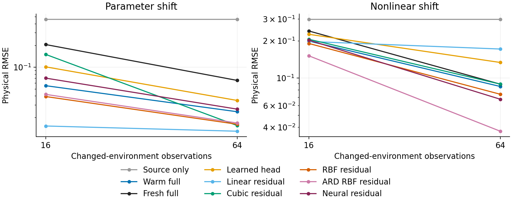

# What Does Weight Access Buy? Initialization, Identification, and Functional Reuse in Learned Dynamics

**Working manuscript, version 4 - November 10, 2026.** Controlled numerical study. Publication novelty and submission readiness remain under review.

## Abstract

Modifying a learned dynamics model can exploit its parameters, internal features, or callable predictions. These access modes are often compared against different baselines or under different deployment restrictions. We study them using small neural acceleration models and four controlled experimental stages. Under a fixed architecture, pretrained initialization improves generalization even after fresh and warm students reach similar calibration errors. With an uncertain mechanism family, query placement can matter more than query count. We then study adaptation from noisy observations of changed dynamics without supplying a physics library. {{ABSTRACT_RESULT}} These findings support evaluating weight access relative to functional reuse, input coverage, and explicit deployment contracts. They do not establish semantic interpretation of weights or a language-model programming capability.

## 1. Introduction

Suppose a network predicts how a physical system evolves, and the system changes. One can fine-tune its parameters, adjust an output head using learned features, or retain the source predictor and learn a correction around its outputs. Each approach reuses prior knowledge, but only the first two require internal access. A comparison against a fresh model learning the entire changed system can therefore overstate what reading the source parameters uniquely provides.

Interest in weight-space programming makes this distinction timely. Recent exploratory reports describe language models inspecting and rewriting network parameters [7,8]. Weight-space learning more broadly already includes architectures that process other networks as structured objects [5]. Our work evaluates numerical access contracts before introducing a language-model editor. It asks when a result reflects initialization, identification assumptions, or a stronger deployment baseline.

The investigation proceeds through four stages. First, a supplied physical library enables strong query-only teachers. Second, fixing the deployment architecture exposes an initialization benefit over fresh students. Third, longer optimization and approximately matched calibration fit test whether that benefit disappears with additional fitting, while hidden-family identification tests sensitivity to query coverage. Fourth, prediction-only residual adaptation tests whether callable source behavior can replace some of the benefit attributed to raw parameters.

The resulting contribution is a reproducible comparison and a diagnosis of these confounds in a controlled setting. The optimizers, regression models, and elementary error identities are established tools. We do not claim a new optimizer, identification algorithm, or general theory of weight-space programming. The systems expose physical state directly; they are learned dynamics predictors rather than visual or latent foundation world models.

## 2. Access contracts and related work

We distinguish three source-access modes. **Parameter access** permits copying or optimizing the source weights. **Feature access** exposes hidden activations, enabling a calibrated head to be folded into the original network. **Prediction access** provides only an executable source function. A method with weights can execute the network too; these are practical computational contracts, not disjoint information-theoretic classes.

Deployment is a separate choice. Fine-tuning and a folded head retain the original architecture. A residual wrapper retains the source function and adds a correction. Its storage and inference costs differ. An advantage for a wrapper does not establish equal-capacity superiority, but it matters when the application permits such deployment. Conversely, an architectural restriction needs an application justification.

System identification from candidate functions is longstanding [1]. Neural functionals process weights while respecting network symmetries [5], and task arithmetic combines parameter changes around a common base [6]. Scale-aware optimization and reparameterization issues also predate this study [2,3]. Distillation [9], the role of teacher initialization [10], and initialization-dependent fine-tuning behavior [11,12] provide additional context. Our controls use these ideas without claiming their first introduction.

Kernel methods and Gaussian-process regression supply established function-space baselines [13]. Residual dynamics learning also has substantial prior work; for example, Brudigam et al. combine Gaussian-process residuals with variational integrators [14]. Our point-prediction residuals around a neural source serve an access comparison. Their use is not a proposed new adaptation algorithm.

## 3. Tasks and systems

The state is position q and velocity v, the action u is an applied force, and a network predicts acceleration. Dynamics satisfy dq/dt=v and dv/dt=f(q,v,u). All source models are two-hidden-layer ReLU MLPs with shape 3-32-32-1 and 1,217 parameters. Training uses 4,096 noiseless source accelerations uniformly sampled from [-1.5,1.5]^3, 2,400 Adam updates, and minibatches of 256. Training uses float32; editing and evaluation use float64.

The earlier stages use Duffing and pendulum-type systems, with a deliberately misspecified Duffing variant as an identification control. The latest stage adds contact forces and state-dependent damping. Its four source accelerations are:

| System | Acceleration |
|---|---|
| Duffing | -kq-cv-aq^3+gu |
| Pendulum | -k sin(q)-cv-av abs(v)+gu |
| Contact | -kq-cv-a sign(q) max(abs(q)-0.7,0)+gu |
| State-dependent damping | -kq-cv+a(1-q^2)v+gu |

Table 1. Source systems. Coefficients vary by independent seed. These formulas define the simulator and are not supplied to the observation-based adapters.

The coefficients k,c,a,g are drawn from [0.7,1.3], [0.2,0.6], [0.1,0.4], and [0.8,1.2]. Matching seed indices pair coefficient draws, observation noise, and initialization across systems. Uncertainty estimates therefore cluster by seed instead of treating every system as independent.

**Specification editing.** In the first three stages, methods receive a candidate mechanism library, a documented interface, and a specified multiplicative coefficient change. No changed-environment observations are provided. Synthetic targets are inferred from source-network queries. The distinction between preserving source errors and reconstructing a symbolic teacher is explicit.

**Observation-based adaptation.** In the latest stage, methods receive 16 or 64 noisy acceleration observations from the changed environment. No library, coefficients, or intervention formula is supplied. The parameter-shift condition increases k by 50% and doubles c. The added-mechanism condition adds -0.2 sin(3q)-0.3 tanh(4v), introducing restoring and friction forces. The two conditions are fixed stress tests, not a distribution of arbitrary new mechanisms. Observation noise is Gaussian with standard deviation 0.01. Source predictions remain callable during adaptation and deployment.

The second task changes the information available to an adapter. Its errors must not be numerically pooled with specification-editing errors as if they measured the same problem.

## 4. Methods and selection

The observation-based study compares nine methods. Source-only is the unchanged reference. Warm full-network adaptation copies the source weights; fresh full-network adaptation uses an independently initialized network with the same architecture. Learned-head adaptation fits an additive correction from frozen hidden activations and folds it into the original output layer.

Prediction-only methods learn the residual between changed-environment observations and source predictions. An affine model and a model containing all monomials through total degree three provide generic low-complexity baselines. Isotropic and coordinate-scaled RBF kernel ridge provide nonlinear smooth corrections. A fresh neural residual uses an independent MLP with a zero-initialized output head, so its initial deployed prediction equals the source prediction. It does not copy the source's internal features.

For a residual kernel with calibration matrix K and residual observations r, prediction has the standard form:

$$ s(x)=f_0(x)+k(x,X)^T(K+n\lambda I)^{-1}r. $$

Feature columns are normalized by their calibration RMS. Ridge choices are 1e-5,1e-4,1e-3,1e-2,0.1. RBF lengths in coordinates x/1.5 are 0.25,0.5,1,2. Isotropic kernels use one shared length; the coordinate-scaled control evaluates all 64 coordinate combinations. Hyperparameters minimize analytic leave-one-out error on calibration residuals. No test labels enter selection.

Neural methods use L-BFGS with strong-Wolfe search and history size 20. A fixed 75%/25% calibration split selects among 30,120,480 iterations. Each selected configuration is refit from the identical initialization using all observations. Timings include selection and refitting. These procedures are not matched FLOP budgets or exhaustive tuning of all possible neural adaptations.

The prespecified primary contrasts compare isotropic RBF residuals against warm full-network and learned-head adaptation under added mechanisms at 64 observations. Coordinate-scaled kernels and neural residuals are additional controls fixed before development execution. We retain all comparisons rather than replacing the primary method after observing a stronger control.

## 5. Earlier controls: what an initialization advantage means

With a correct low-dimensional library, identifying its coefficients from source queries already yields a strong teacher. If f_theta(x)=phi(x)^T c+e(x) and the calibration feature matrix Phi has full column rank, then the least-squares coefficient error is:

$$ \widehat{c}-c=\Phi^\dagger e_X. $$

A specified coefficient edit represented by M changes the source residual teacher's physical error to:

$$ e(x)+\phi(x)^T M\Phi^\dagger e_X. $$

These identities explain both the strength of structured query baselines and sensitivity to query coverage. They are elementary regression facts. A symbolic replacement can remove part of the source approximation error, whereas a residual teacher preserves it. Better unrestricted teacher accuracy need not imply better accuracy after approximation by a finite student.

The initial sweep trained 36 source models and evaluated 7,776 condition-method rows. At 128 queries with matched libraries, query residual and symbolic replacement errors were 0.0149 and 0.0056, versus 0.0174 for the best mean-performing tested numerical weight editor. These comparisons use different deployment contracts and are exploratory screening evidence.

The next study used 24 new source models on seeds 20-31 with a frozen protocol. Under a fixed architecture and sparse symbolic supervision, warm versus fresh L-BFGS errors were 0.0195 versus 0.0377. With 4,096 free symbolic labels and a longer Adam schedule, warm versus fresh errors were 0.0119 versus 0.0175. The dense control strengthens the prediction-derived teacher without spending additional source queries.

{{MATCHED_FIT_RESULT}}

{{QUERY_DESIGN_RESULT}}

These controls establish useful initialization and coverage effects in this benchmark. They do not uniquely identify a generalization mechanism or establish that source behavior must be accessed through raw parameters. Effects of initialization and feature distortion are already studied extensively [11,12].

## 6. Observation-based adaptation without a physics library

The latest protocol was frozen in Git before evaluating seeds 60-71. It trains 48 new source networks across four systems and evaluates both shifts, two observation budgets, and nine methods, producing 1,728 condition-method rows. The development seeds 0-1 are excluded from effect estimates. {{SOURCE_FIDELITY}}

We evaluate 1,024 noiseless test accelerations in [-1.25,1.25]^3 and 1,024 extrapolation points outside the training cube but inside [-2,2]^3. Rollouts use 24 initial states and 100 semi-implicit Euler steps at dt=0.03, compared against the changed analytic system under the identical integrator and force sequence. Rollout evaluation assesses prediction rather than planning or closed-loop utility.

### 6.1 Internal access versus prediction-only residuals

{{MAIN_RESULT}}

{{MAIN_TABLE}}

Table 2. Added-mechanism shift, 64 noisy observations, averaged within each of 12 seed clusters. Lower error is better. Extra scalars are approximate additional stored floating-point values beyond one 1,217-parameter predictor; wrappers differ from in-place edits. Complete intervals and hyperparameters are in the archived report.

{{PAIRED_RESULT}}

Figure 1. Observation-based adaptation by label budget. Points are seed-cluster means; uncertainty intervals are archived in the report. Both panels use the same source models and selection procedures. The parameter shift has an affine correction by construction; the added-mechanism shift introduces nonlinear forces. Performance on one is not evidence for all forms of adaptation.

### 6.2 Source reuse and correction complexity

{{PARAMETER_RESULT}}

{{SYSTEM_RESULT}}

A source-plus-correction method can retain useful behavior without copying its internal representation into a student. This makes fresh full-network retraining an incomplete baseline for claims about the unique value of parameter access. It does not imply that all corrections are low-complexity or that function-only reuse always matches internal adaptation.

### 6.3 Deployment and resource accounting

Warm, fresh, and folded-head models deploy the original architecture. Linear, cubic, and RBF wrappers additionally store residual parameters or calibration centers. The fresh neural residual retains an additional network. All have the same changed-environment label budget, but different inference work, storage, and hyperparameter-search cost. No equal-capacity or universal speedup claim follows from Table 2.

Source pretraining is a sunk cost only when the source already exists for another purpose. Timings are descriptive measurements from one CPU setup, with some overlapping experiment jobs. {{INTEGRITY_RESULT}}

## 7. Interpretation and limits

The results support separating three questions. Does copying source parameters help a particular student optimizer? Can source queries identify the intended dynamics under a stated prior? Does an internal-access method improve on a prediction-only method that retains the source function at deployment? Each question needs an appropriate baseline and information budget.

The observation-based study removes the named mechanism library but retains other favorable assumptions: low-dimensional observed state, freely chosen calibration inputs, direct acceleration measurements, smooth fixed force changes, and an executable source model at inference. Polynomial and kernel methods impose generic function-class priors. None is assumption-free. The added mechanisms are shared across source contexts, and the study does not show transfer to arbitrary unseen intervention families.

Frozen-head comparisons depend on the source training objective, network width, and the representational needs of a new force. Full adaptation could improve with other architectures, regularizers, optimizers, or larger budgets. We do not establish the optimum attainable under every access mode. The four systems also share a two-state, one-action interface. These findings cannot be extrapolated directly to high-dimensional observations, visual world models, latent-state identifiability, or long-horizon control.

Approximate matched fitting reduces one confound but does not causally separate optimization path from an initialization-dependent functional prior. Query-placement controls concern evaluations of a learned predictor, not physical exploration of an unknown changed world. Classification counts under a two-family candidate set are empirical observations, not population-perfect identification guarantees.

Finally, no language model is evaluated. The study neither replicates nor refutes LLM weight-reading demonstrations. A language-model programming claim would require frozen access arms, prompt and token budgets, held-out models, repeated trials, and a distinction between numerical weight generation and an agent writing adaptation code.

## 8. Research conclusion

{{CONCLUSION}}

The next substantive test should move beyond clean physical coordinates or vary the intervention family, while retaining strong prediction-only residual competitors. Enlarging these small-system sweeps alone will not establish novelty. The artifact is a controlled empirical case study; publication value still requires a finding beyond established transfer-learning, regression, and identification principles.

## Reproducibility and disclosure

Protocols were committed before the corresponding fresh-seed evaluations. Independent seed clusters, not individual state points or equivalent parameterizations, are the units of uncertainty. Reported 95% intervals are descriptive percentile bootstraps with 5,000 resamples and no multiplicity adjustment. All methods share calibration observations; evaluation labels are never used for fitting or selection. Raw rows, optimizer traces, checkpoints, source hashes, manifests, and development results remain in the repository. Earlier manuscript versions are preserved in Git. No paid APIs or rented accelerators were used.

## References

{{REFERENCES}}
