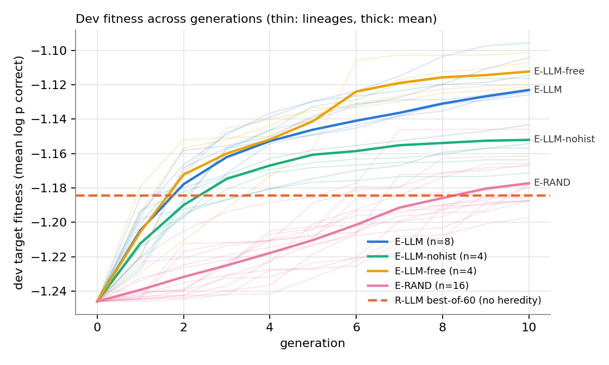
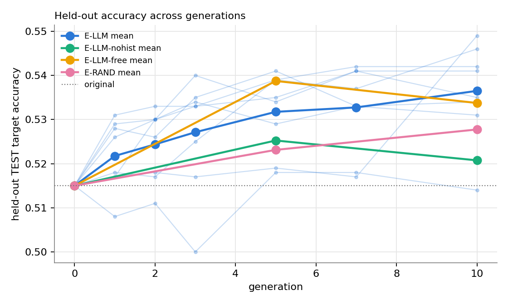
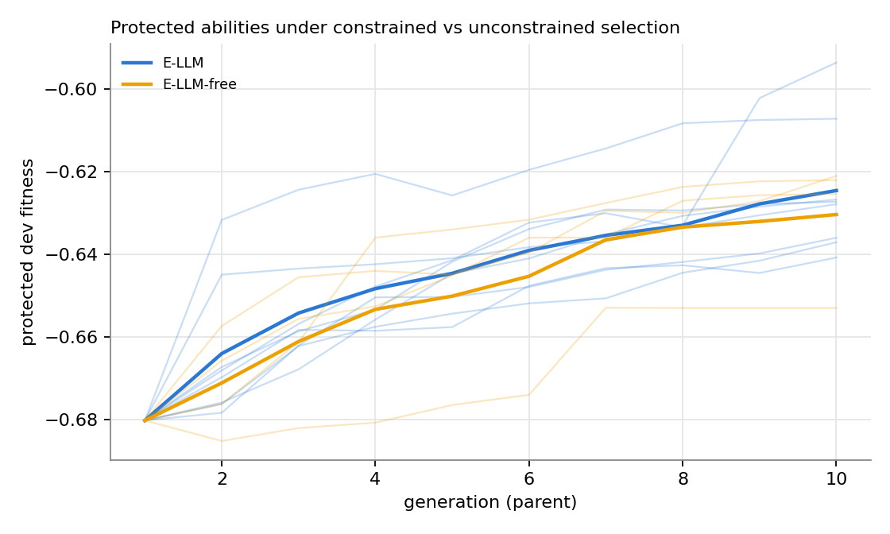
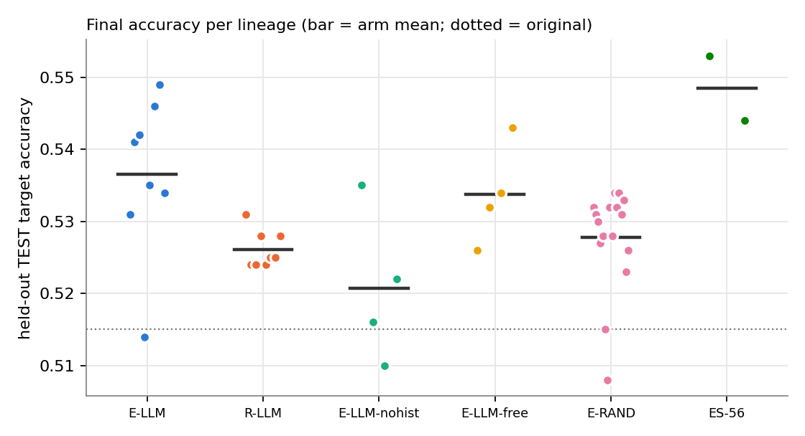

# Model evolution by WSP: results

Generated by `python -m experiments.evolution.analyze`. All numbers trace to `results/evolution/`.

Original model test target accuracy: **0.5150**; protected accuracy 0.6420; WikiText test NLL 3.0748.

## Per-arm final held-out results (generation 10; R-LLM: best-of; ES-56: best within 60 evaluations)

ES-56 = frozen seeds 1-2; ES-56+ = all seeds (seeds >= 3 are an addition beyond the frozen protocol). 'Pass' = test protected fitness >= original - 0.02 and test NLL <= original + 0.02 (the dev admissibility rule applied to test).

| Arm | Units | Test target acc (mean; per-unit) | Δ vs original [95% CI] | Protected acc | Test NLL | Pass test constraints |
|---|---|---|---|---|---|---|
| E-LLM | 8 | 0.5365 (0.531, 0.541, 0.542, 0.514, 0.535, 0.546, 0.549, 0.534*) | +0.0215 [-0.0020, +0.0446] | 0.6725 | 3.0850 | 7/8 |
| R-LLM | 8 | 0.5261 (0.531, 0.524, 0.524, 0.528, 0.524, 0.525, 0.525, 0.528) | +0.0111 [-0.0010, +0.0232] | 0.6585 | 3.0773 | 8/8 |
| E-LLM-nohist | 4 | 0.5208 (0.535, 0.516, 0.510, 0.522) | +0.0058 [-0.0210, +0.0310] | 0.6660 | 3.0810 | 4/4 |
| E-LLM-free | 4 | 0.5337 (0.526, 0.532, 0.534, 0.543) | +0.0187 [-0.0025, +0.0408] | 0.6665 | 3.0832 | 4/4 |
| E-RAND | 16 | 0.5278 (0.532, 0.531, 0.530, 0.527, 0.528*, 0.515, 0.508, 0.532, 0.528, 0.534, 0.532, 0.534, 0.531, 0.533, 0.523, 0.526) | +0.0128 [-0.0012, +0.0267] | 0.6610 | 3.0838 | 15/16 |
| ES-56 | 2 | 0.5485 (0.553*, 0.544) | +0.0335 [+0.0130, +0.0560] | 0.6880 | 3.0907 | 1/2 |

(*) = fails the test constraints.

## Contrasts (hierarchical bootstrap over lineages and paired test items)

| Contrast | Δ acc | 95% CI |
|---|---|---|
| C1 heredity: E-LLM − R-LLM | +0.0104 | [-0.0104, +0.0314] |
| C2 LLM content vs magnitude-matched random: E-LLM − E-RAND | +0.0087 | [-0.0081, +0.0249] |
| C3 vs CMA-ES (60 evals): E-LLM − ES-56 | -0.0120 | [-0.0329, +0.0074] |
| C4 lineage memory: E-LLM − E-LLM-nohist | +0.0157 | [-0.0011, +0.0340] |
| weight heredity without memory: E-LLM-nohist − R-LLM | -0.0054 | [-0.0301, +0.0171] |
| admissibility constraint: E-LLM − E-LLM-free | +0.0028 | [-0.0116, +0.0172] |

### Same contrasts restricted to units that pass the test constraints (sensitivity analysis)

| Contrast | units (A, B) | Δ acc | 95% CI |
|---|---|---|---|
| E-LLM − R-LLM | 7, 8 | +0.0107 | [-0.0114, +0.0316] |
| E-LLM − E-RAND | 7, 15 | +0.0091 | [-0.0095, +0.0262] |
| E-LLM − ES-56 | 7, 1 | -0.0071 | [-0.0260, +0.0117] |
| E-LLM − E-LLM-nohist | 7, 4 | +0.0161 | [-0.0012, +0.0348] |
| E-LLM − E-LLM-free | 7, 4 | +0.0031 | [-0.0123, +0.0186] |

## Cost per unit

Evaluations = dev evaluations of candidate models used for selection.

| Arm | Units | Dev evaluations per unit | Editor $ per unit | Wall-clock min per unit (selection loop) |
|---|---|---|---|---|
| E-LLM | 8 | 58 | $0.498 | 16.1 |
| R-LLM | 8 | 60 | $0.372 | 9.5 |
| E-LLM-nohist | 4 | 59 | $0.350 | 11.8 |
| E-LLM-free | 4 | 58 | $0.522 | 13.2 |
| E-RAND | 16 | 60 | $0.000 | 11.6 |
| ES-56 | 2 | 60 (300 also tested) | $0.000 | n/a |

## Generational trajectories

### E-LLM held-out target accuracy by generation

| Lineage | g0 | g1 | g2 | g3 | g5 | g7 | g10 | accepted | genome ops |
|---|---|---|---|---|---|---|---|---|---|
| E-LLM_1 | 0.515 | 0.528 | 0.526 | 0.535 | 0.541 | 0.533 | 0.531 | 10/10 | 10 |
| E-LLM_2 | 0.515 | 0.529 | 0.530 | 0.540 | 0.534 | 0.541 | 0.541 | 10/10 | 10 |
| E-LLM_3 | 0.515 | 0.531 | 0.533 | 0.533 | 0.539 | 0.542 | 0.542 | 10/10 | 10 |
| E-LLM_4 | 0.515 | 0.508 | 0.511 | 0.500 | 0.518 | 0.518 | 0.514 | 10/10 | 10 |
| E-LLM_5 | 0.515 | 0.526 | 0.530 | 0.533 | 0.535 | 0.541 | 0.535 | 10/10 | 10 |
| E-LLM_6 | 0.515 | 0.518 | 0.517 | 0.525 | 0.539 | 0.537 | 0.546 | 10/10 | 10 |
| E-LLM_7 | 0.515 | 0.517 | 0.518 | 0.517 | 0.519 | 0.517 | 0.549 | 10/10 | 10 |
| E-LLM_8 | 0.515 | 0.517 | 0.530 | 0.534 | 0.529 | 0.533 | 0.534 | 10/10 | 10 |

## Mutation-operator statistics

| Arm | Generations | Valid offspring | Improving | Admissible & improving | Accepted gens | Editor cost |
|---|---|---|---|---|---|---|
| E-LLM | 80 | 465/480 | 305 | 301 | 80 | $3.98 |
| R-LLM | 80 | 480/480 | 293 | 288 | 0 | $2.97 |
| E-LLM-nohist | 40 | 235/240 | 76 | 75 | 34 | $1.40 |
| E-LLM-free | 40 | 230/240 | 134 | 134 | 37 | $2.09 |
| E-RAND | 160 | 960/960 | 493 | 489 | 158 | $0.00 |

Editor spend committed in ledger: **$10.52** of the $20.00 hard cap (259 calls).
