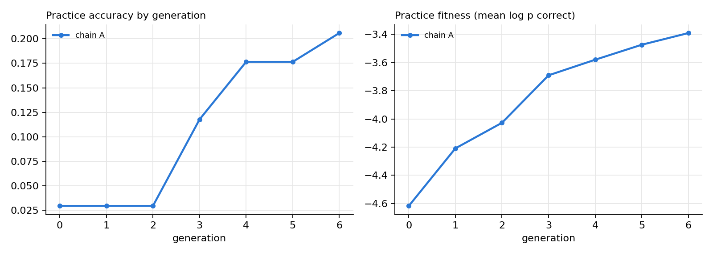

# Skill-programming pilot: results

Protocol: `docs/skill-pilot-protocol.md` (frozen before any result). Skill **ENC**: `ENC: c ->` -> ` d` (next letter).
Held-out letters (never shown to the editor): **a d h o q t u v**. Held-out format: `'Input: ENC {x}\nOutput:'`.

## Headline results (exact-match accuracy, argmax over the full vocabulary)

| Method | Practice (seen letters, seen formats) | Held-out letters (PRIMARY) | Held-out format | Held-out letters + format | Verdict |
|---|---|---|---|---|---|

Verdict rules (pre-registered): WORKS = held-out letters >= .80 with no regression; PARTIAL = practice >= .80 and held-out < .50; FAILS = held-out < .30.

## Chain A: what the editor changed

Generations: 6; accepted: 6; valid proposals: 36/36.

Accepted ops: 14. Layer range 20–26. Ops touching a successor head (L21h6, L22h8, L25h8, L25h9): **3** (L21.attn.o h6, L25.attn.o h8, L25.attn.o h9).
Op types: rank1 5, scale 9.

| gen | op | tensor | head |
|---|---|---|---|
| 1 | rank1 | L20.attn.o |  |
| 1 | scale | L23.attn.o | 14 |
| 2 | rank1 | L24.mlp.down |  |
| 3 | scale | L23.attn.o | 14 |
| 3 | scale | L21.attn.o | 6 |
| 3 | scale | L25.attn.o | 8 |
| 3 | scale | L25.attn.o | 9 |
| 3 | scale | L23.attn.o | 7 |
| 3 | scale | L22.attn.o | 9 |
| 4 | scale | L21.attn.o |  |
| 4 | scale | L23.attn.o | 14 |
| 5 | rank1 | L26.mlp.down |  |
| 5 | rank1 | L22.attn.o |  |
| 6 | rank1 | L20.attn.o |  |

Editor's final analysis: _Successor heads (L21h6, L23h14, L25h8/9) carry the rule. Boosting them gave the biggest gains, but the protected margin is now tight (0.0039). The main error is copying the current letter. The paren format also leaks ' '. Damping the anti-successor heads improved the protected score before. So I pair successor boosts with those dampings to offset protected-score cost. I also try new gated format-mapping sites (L24 and L25 attention output, L20 again) at small alpha, plus one conservative pure-damping edit._

## Theory and its predictions

- **Interpolation barrier:** affine readout maps fit on practice letters reach practice 1.00 but held-out max 0.00 over all 29 layers and ranks 1–8 (shuffled-target floor 0.039). Readout/lookup edits cannot generalize.
- **Latent competence:** sequence contexts already compute the successor (alphabet-primed: practice 1.00, held 1.00; 3-letter run: 0.88/0.71); natural-language prompts do not (0.00).
- **Successor heads (weights only):** L21h6 succ 0.64 (held 0.75), L22h8 succ 0.56 (held 0.50), L25h8 succ 0.28 (held 0.25), L25h9 succ 0.24 (held 0.38); chance 0.04.
- **Prediction:** routing the trigger into the successor heads should reach held-out letters ≈ 0.6–0.8; per-letter writes should give ≈ 0.

## Cost

Editor spend for the pilot chains: $0.44 (ledger, with 1.15 safety factor).

